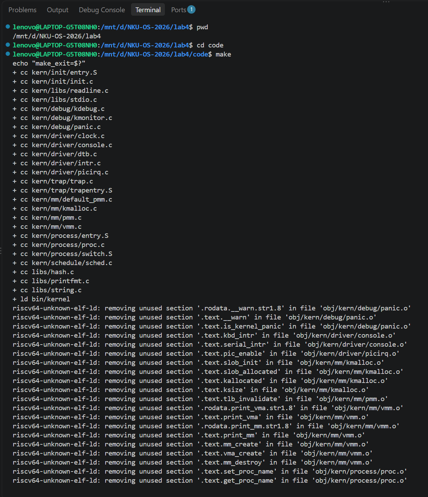
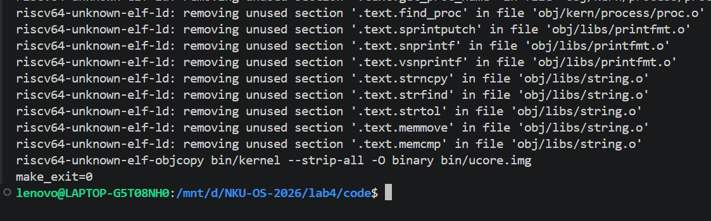
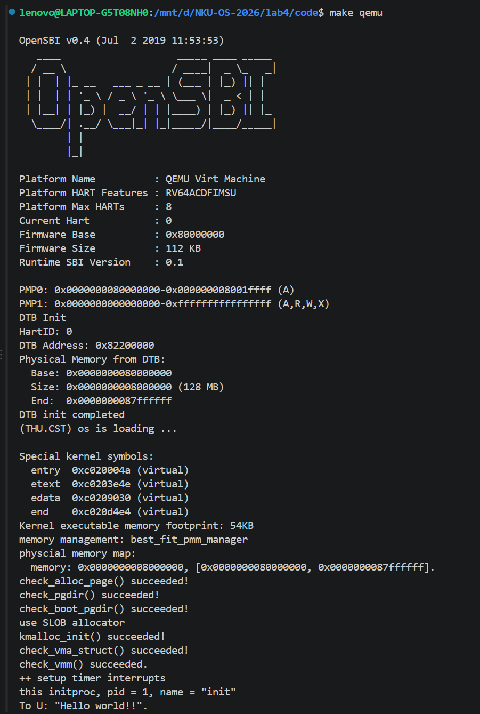
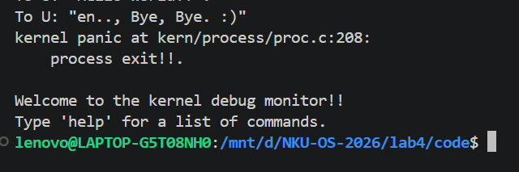
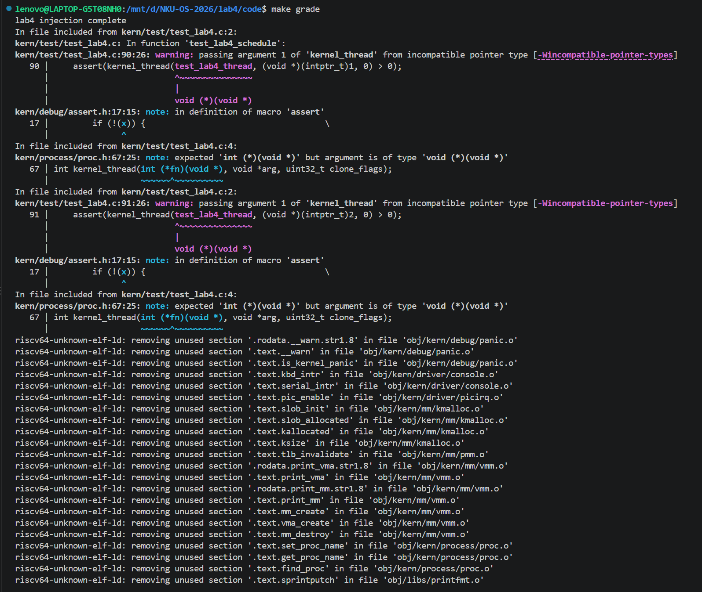
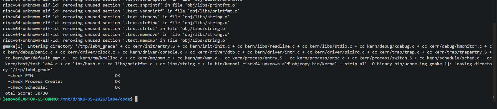

# 操作系统实验报告

Lab4：进程管理

## 实验基本信息

| 项目 | 内容 |
| --- | --- |
| 实验名称 | Lab4：进程管理 |
| 小组成员 | 2411788-马传志、2413507-蒋林瀞、2412096-王麒萱 |
| 完成日期 | 2026.11.11 |

表1 实验基本信息

### 小组分工

| 成员 | 负责的练习/模块 |
| --- | --- |
| A 2412096-王麒萱 | 功能模块一：虚拟内存页操作（`page_insert`、`page_remove`）；Lab2/Lab3 前置代码迁移与集成；Challenge 2 分页模式分析 |
| B 2413507-蒋林瀞 | 功能模块二：进程创建与初始化（`alloc_proc`、`proc_init`、`kernel_thread`、`do_fork`、`copy_thread`、`copy_mm`）；进程创建测试、首次运行调试及 Challenge 答案分析 |
| C 2411788-马传志 | 功能模块三：进程调度（`cpu_idle`、`proc_run`、`schedule`、`switch_to`）；调度测试、上下文切换调试及 Challenge 1 中断开关 |

表2 小组分工

各成员分别记录所负责模块的实现过程和测试结果，小组共同整理启动流程、集成测试及总结。四段式提示词统一收录在 [提示词记录](prompt.md) 中，按成员 A、B、C 的顺序排列。

## 一、实验目的

1. 理解虚拟地址映射、物理页引用计数和 TLB 的关系，掌握页表映射的建立、修改和撤销方法。
2. 掌握内核线程的创建方法，理解进程控制块、内核栈和线程运行现场的组织方式。
3. 掌握线程调度及上下文切换方法，理解就绪线程的选择规则和寄存器保存约定。

## 二、实验环境

在 Windows 下的 WSL Ubuntu 中编译、运行和调试内核，用 QEMU 模拟 RISC-V 64 位处理器，并通过 GDB 连接 QEMU 进行单步调试。

| 项目 | 配置 |
| --- | --- |
| 终端环境 | Windows 下的 WSL Ubuntu |
| 目标架构 | RISC-V 64 位，Sv39 分页 |
| 交叉编译器 | SiFive riscv64-unknown-elf-gcc 10.1.0、10.2.0 |
| 调试器 | riscv64-unknown-elf-gdb |
| 运行方式 | QEMU 4.1.1 Virt Machine，OpenSBI v0.4 |

表3 软件环境

| 成员 | AI 编程工具 | 底层模型 | 用途 |
| --- | --- | --- | --- |
| A 2412096-王麒萱 | Codex | gpt-6.1-sol | 页操作代码、前置代码迁移、实验集成 |
| B 2413507-蒋林瀞 | Claude Code | Claude Opus 5.5 | 进程创建代码、故障注入测试、GDB 调试 |
| C 2411788-马传志 | Codex | gpt-6.1-sol | 调度代码、寄存器测试、GDB 调试 |

表4 AI 工具

## 三、实验整体逻辑与原理

### 3.1 内核启动流程

先建立页表映射，再创建内核线程，然后通过调度器选择就绪线程运行。内核的启动流程如下：

```text
kern_init -> pmm_init -> idt_init -> vmm_init -> proc_init -> clock_init -> cpu_idle
                                                    |                          |
                                       创建 idleproc 与 initproc       schedule -> proc_run -> switch_to
```

先初始化内存、页表和 Trap 入口，再初始化 idle 和 init 线程。进入空闲循环后，根据调度标志选择就绪线程，切换页表根和寄存器现场。

### 3.2 实验步骤

1. 迁移 Lab2/Lab3 的前置代码。使用页分配器分配物理页和内核栈，使用 `kmalloc` 分配 PCB，并沿 `__trapret` 恢复线程运行现场。
2. 编写页操作代码。建立和撤销虚拟地址映射，维护物理页引用计数，并使对应的 TLB 翻译失效。
3. 编写线程创建代码。分配 PCB 和内核栈，填写 trapframe、context、PID 及链表节点，将线程状态设为 `PROC_RUNNABLE`。
4. 编写调度代码。按进程链表选择就绪线程，更新 `current` 和 `satp`，再保存、加载寄存器。

按调度接口的约定填写线程信息：将 `pgdir` 设为页对齐的根页表物理地址，通过 `idleproc` 单独引用空闲线程，将普通线程登记到 `proc_list`。新线程的 `context.ra` 设为 `forkret`，`context.sp` 按 16 字节对齐。

### 3.3 线程执行现场

线程切换和中断返回需要保存不同的现场。使用 `context` 记录函数调用边界上的线程现场，使用 `trapframe` 记录中断或异常入口的现场。两者保存的内容和恢复方式如下。

| 项目 | `struct context` | `struct trapframe` |
| --- | --- | --- |
| 内容 | `ra`、`sp`、`s0`～`s11`，共 14 个字段 | 32 个通用寄存器及 `status`、`epc`、`badvaddr`、`cause`，共 36 个字段 |
| 保存位置 | 调用 `switch_to` 的线程切换边界 | 中断或异常入口 |
| 保存依据 | 按函数调用约定保存被调用者保存寄存器；调用方保存需要跨调用保留的其余值 | 按 Trap 现场布局保存通用寄存器和 CSR |
| 恢复方式 | 加载 `context`，执行 `ret` | 加载 trapframe，执行 `sret` |

表5 线程执行现场

先根据 `context.ra` 跳转到 `forkret`，再通过 Trap 返回路径恢复 trapframe 中记录的寄存器现场，进入线程入口。创建线程的阶段负责填写这两份现场，调度阶段使用这些数据切换执行流。

## 四、实验过程

### 4.1 迁移 Lab2、Lab3 代码

负责人：A 2412096-王麒萱。

将 Lab2 的页分配器、`page_init` 和 Lab3 的 Trap 入口、处理代码迁入 Lab4，再依次合入页操作、调度和进程创建代码。执行整包编译，链接生成内核镜像。

### 4.2 功能模块一：虚拟内存页操作

负责人：A 2412096-王麒萱。

#### 模块功能

编写以下两个函数，建立和撤销虚拟地址映射，同时维护物理页引用计数及 TLB 状态。

```c
int page_insert(pde_t *pgdir, struct Page *page, uintptr_t la, uint32_t perm);
void page_remove(pde_t *pgdir, uintptr_t la);
```

#### 页表映射操作

先调用 `get_pte(pgdir, la, 1)` 查找目标页表项，并按需分配中间页表。取得页表项后，再增加目标物理页的引用计数，并根据原映射选择处理分支：

```c
page_ref_inc(page);
if (*ptep & PTE_V)
{
    if (pte2page(*ptep) == page)
    {
        page_ref_dec(page);
    }
    else
    {
        page_remove_pte(pgdir, la, ptep);
    }
}
*ptep = pte_create(page2ppn(page), perm);
flush_tlb();
```

若原页表项无效，直接写入新映射；若原地址已经指向同一物理页，先抵消刚增加的引用计数，再更新权限；若需要替换为另一物理页，先撤销旧映射并减少旧页引用计数，计数归零就释放旧页，然后写入新映射。

在调用前保存根目录项原值。若中间页表分配失败，先判断根目录项是否由本次操作新建。对于第一张中间页表分配成功、第二张分配失败且根目录项为本次新建的情况，恢复原目录项，调用 `flush_tlb()`，减少新页表页的引用计数并按计数释放。分配失败统一返回 `-E_NO_MEM`。取得页表项指针后再增加目标数据页引用计数，因此分配失败分支保持该计数的原值。

先调用 `get_pte(pgdir, la, 0)` 沿已有页表查找，再清零有效叶项，使用 `tlb_invalidate()` 使该地址的旧翻译失效，并减少物理页引用计数。计数归零就释放物理页；若叶项无效或中间页表缺失，直接返回。重复删除同一地址也按这两个条件判断。

分别回收数据页和中间页表页。在启动测试中，先撤销数据页映射，再释放两层页表页。插入映射和失败回滚涉及非叶项变化，因此使用 `flush_tlb()` 刷新本 hart 的全部地址翻译；删除叶项则采用单地址失效。页表分配分支采用代码路径分析，运行验证使用正常启动和评分输出。

#### 代码修改记录

第一轮编写映射插入、删除和引用计数维护代码，执行 `make -B obj/kern/mm/pmm.o`，编译返回 0。集成阶段合入进程创建和调度模块，补齐 `proc_init`、`cpu_idle`。

第二轮根据非叶页表项的变化范围，将插入成功及中间页表回滚处的单地址失效改为 `flush_tlb()`，删除叶项继续使用 `tlb_invalidate()`。修改后重新编译 `pmm.o`，返回值为 0。

合并三人的代码后，执行 `make`，编译内存、进程和调度模块，并链接生成 `bin/kernel`。日志中的 `removing unused section` 对应链接器对未引用节的清理。



图4-1 内核代码编译过程

使用 `objcopy` 生成 `bin/ucore.img`，编译返回状态为 `make_exit=0`。



图4-2 内核编译结果

### 4.3 功能模块二：内核线程创建

负责人：B 2413507-蒋林瀞。

#### 模块功能

按以下六个函数编写线程创建代码，分配进程控制块和内核栈，设置线程运行现场，并登记 idle、init 线程。

```c
static struct proc_struct *alloc_proc(void);
void proc_init(void);
int kernel_thread(int (*fn)(void *), void *arg, uint32_t clone_flags);
int do_fork(uint32_t clone_flags, uintptr_t stack, struct trapframe *tf);
static void copy_thread(struct proc_struct *proc, uintptr_t esp, struct trapframe *tf);
static int copy_mm(uint32_t clone_flags, struct proc_struct *proc);
```

使用 `kmalloc/kfree` 分配和回收 PCB，使用 `alloc_pages/free_pages` 分配和回收内核栈，并以 `boot_pgdir_pa` 作为线程的页表根。先将启动执行流登记为 PID 0 的 `idleproc`，再创建具有独立内核栈的 `initproc`。

按 PCB、trapframe、内核栈、地址空间和登记信息组织创建流程。先分配资源、填写现场，再分配 PID、加入链表，并将线程状态设为 `PROC_RUNNABLE`。

#### 4.3.1 初始化进程控制块

先调用 `kmalloc` 分配 `struct proc_struct` 并清零整个结构，再填写状态、PID、页表根和链表节点：

```c
memset(proc, 0, sizeof(struct proc_struct));
proc->state = PROC_UNINIT;
proc->pid = -1;
proc->pgdir = boot_pgdir_pa;
list_init(&(proc->list_link));
list_init(&(proc->hash_link));
```

- 将 `state` 设为 `PROC_UNINIT`，表示 PCB 正在构造；根据 `PROC_RUNNABLE` 选择就绪线程。
- 将 `pid` 初值设为 `-1`，登记线程前再调用 `get_pid` 分配 PID。
- 将 `pgdir` 设为根页表物理地址 `boot_pgdir_pa`。切换线程前，按 `(8 << 60) | (pgdir >> 12)` 构造 Sv39 的 satp 值。
- 将两个链表节点初始化为自环，使前驱、后继指针都指向节点自身。

如果分配 PCB 失败，就返回 `NULL`，并保持全局进程链表和计数的原值。

#### 4.3.2 设置线程入口

在 trapframe 中填写入口地址、参数和状态寄存器，再沿 `__trapret` 和 `sret` 恢复寄存器并跳转到入口。线程入口的汇编如下：

```asm
kernel_thread_entry:
    move a0, s1
    jalr s0
    jal do_exit
```

根据这三条指令的约定，将函数地址写入 `s0`，将参数写入 `s1`，并设置返回地址和状态位：

```c
memset(&tf, 0, sizeof(struct trapframe));
tf.gpr.s0 = (uintptr_t)fn;
tf.gpr.s1 = (uintptr_t)arg;
tf.status = (read_csr(sstatus) | SSTATUS_SPP | SSTATUS_SPIE) & ~SSTATUS_SIE;
tf.epc = (uintptr_t)kernel_thread_entry;
return do_fork(clone_flags | CLONE_VM, 0, &tf);
```

- 设置 `SPP=1`，使 `sret` 返回 S 态。
- 设置 `SPIE=1`，通过 `sret` 将该值复制到 SIE，打开线程运行所需的中断。
- 清除 `SIE`，使 CSR 和通用寄存器恢复期间保持关中断状态，再通过 `sret` 恢复中断使能。

临时 `tf` 使用创建函数的调用栈，函数返回后便会失效，因此先将它复制到子线程的内核栈。传入 `stack=0` 表示采用内核线程的栈设置约定，`CLONE_VM` 表示共享当前地址空间。

#### 4.3.3 创建内核线程

先分配 PCB 和内核栈，填写地址空间和运行现场，再分配 PID 并登记线程。各步骤及失败返回值如下：

```text
检查 nr_process 上限       失败: -E_NO_FREE_PROC，什么都没分配
alloc_proc                 失败: -E_NO_MEM，什么都没分配
proc->parent = current
setup_kstack               失败: kfree(proc)
copy_mm                    失败: put_kstack, kfree(proc)
copy_thread                不会失败
关中断 {
    get_pid, hash_proc, list_add, nr_process++, wakeup_proc
}
返回 pid
```

按资源分配的逆序编写回滚标签，释放已经分配的资源：

```c
bad_fork_cleanup_kstack:
    put_kstack(proc);
bad_fork_cleanup_proc:
    kfree(proc);
    goto fork_out;
```

若地址空间设置失败，先释放内核栈，再释放 PCB；若内核栈分配失败，直接释放 PCB。资源和现场设置成功后，再分配 PID、挂接链表并增加进程计数。

将 PID 分配、哈希表挂接、链表挂接及 `nr_process` 增加放在同一临界区，通过 `local_intr_save` 和 `local_intr_restore` 保护这些操作。填好资源和现场后，调用 `wakeup_proc` 将线程状态改为 `PROC_RUNNABLE`。若资源分配失败，沿清理分支返回错误码，并保持 PID 分配位置和进程计数的原值。

#### 4.3.4 设置地址空间

将内核线程的 `mm` 设为 `NULL`，共用内核页表。通过 `copy_mm` 读取当前线程的 `mm`：若值为 `NULL`，将子线程的 `mm` 也设为 `NULL`，返回 0；若值为非空，返回 `-E_INVAL`，并沿创建流程释放已经分配的资源。

#### 4.3.5 设置内核栈

先将 trapframe 安排在子线程内核栈顶下方，复制入口现场，再填写子线程返回值和上下文：

```c
proc->tf = (struct trapframe *)(proc->kstack + KSTACKSIZE) - 1;
*(proc->tf) = *tf;
proc->tf->gpr.a0 = 0;
proc->tf->gpr.sp = (esp == 0) ? (uintptr_t)proc->tf : esp;
proc->context.ra = (uintptr_t)forkret;
proc->context.sp = (uintptr_t)(proc->tf);
```

- 用栈顶指针减去一个 trapframe 的大小，得到 `proc->tf`。RV64 下 trapframe 为 36 × 8 = 288 字节，结合页对齐的 `kstack`，可以满足 16 字节栈对齐要求。使用 `_Static_assert` 写出该条件。
- 将 `a0` 设为 0，对应 fork 的子进程返回值；内核线程进入 `kernel_thread_entry` 后，再将函数参数写入 `a0`。
- 若 `esp=0`，将 `gpr.sp` 设为 trapframe 地址，执行 `sret` 后即可沿该地址向低地址使用线程栈；若 `esp` 为非零值，采用调用者给出的栈指针。
- 将 `context.ra` 设为 `forkret`，将 `context.sp` 设为 `tf`。加载这两个字段并执行 `ret`，即可转入 `forkret`。

新线程从调度入口到开始运行的路径如下：

```text
schedule -> proc_run -> switch_to(&prev->context, &proc->context)
  ret 到 context.ra = forkret，sp = tf
forkret -> forkrets(current->tf)          sp <- tf
__trapret: RESTORE_ALL                   写 sstatus/sepc，恢复 s0=fn, s1=arg, sp
sret                                     pc <- kernel_thread_entry，SIE <- SPIE
kernel_thread_entry: a0 <- s1; jalr s0   执行 fn(arg)
```

#### 4.3.6 初始化 idle 和 init 线程

先初始化 `proc_list` 和 1024 个哈希桶，再为启动执行流建立 idle 的 PCB，填写 PID、内核栈及调度标志：

```c
idleproc->pid = 0;
idleproc->state = PROC_RUNNABLE;
idleproc->kstack = (uintptr_t)bootstack;
idleproc->need_resched = 1;
set_proc_name(idleproc, "idle");
nr_process++;
current = idleproc;
```

将 idle 的内核栈指向启动栈 `bootstack`，并用独立的 `idleproc` 指针引用它。将普通线程登记到 `proc_list` 和 PID 哈希表，通过调度器的回退分支选择 idle。将 `need_resched` 设为 1，使空闲循环触发调度。

将 idle 的 `tf`、`context` 和 `runs` 初值设为 0。首次切出启动执行流，再将寄存器保存到 idle 的 `context`。

调用 `kernel_thread(init_main, "Hello world!!", 0)` 创建 init。创建操作从 idle 线程发起，因此将 init 的 `parent` 指向 idle。为 init 分配得到 PID 1，再使用 `find_proc` 取得 PCB，将名称设为 `init`。若分配或创建失败，调用 `panic` 输出错误信息。

#### 代码修改记录

##### 第一轮：编写线程创建代码

第一轮依次编写 `alloc_proc`、线程创建函数和 `proc_init`，并分阶段编译。整包编译成功后，执行 `make qemu`，记录 init 线程的三行输出。

使用 SiFive 工具链编译评分副本，执行评分测试并记录输出。

##### 第二轮：补充中断状态测试

第二轮在代码副本中逐项注入 9 种错误，依次运行各组测试，检查相应断言。

将一项创建测试安排到 `init_main`，从 SIE=1 的状态调用创建接口，并读取 trapframe 中的 status。运行变异测试，9 种变异均使测试失败。进程创建模块的 61 项检查、正式评分和 GDB 调试结果分别记录在第五节。

### 4.4 功能模块三：线程调度

负责人：C 2411788-马传志。

#### 模块功能

在 `cpu_idle`、`schedule`、`proc_run` 和 `switch_to` 中编写调度代码，完成空闲循环、就绪线程选择、页表切换和寄存器切换。先填写 PCB、内核栈和初始现场，再通过调度代码使用这些数据切换执行线程。

新线程沿 `forkret -> forkrets -> __trapret -> kernel_thread_entry` 进入线程函数；已经运行过的线程从上一次调用 `switch_to` 的返回位置继续执行。

#### 线程调度实现

在空闲循环中读取 `need_resched`，若该标志置位，就调用调度器。先清除当前线程的调度标志，再按进程链表查找就绪线程：普通线程从自身的后继开始查找，idle 从链表头开始；遍历中跳过非就绪节点，遇到表头就回到链表起点。选中线程后，将其 `runs` 加一。若再次选中当前线程，就继续运行；若普通线程均处于非就绪状态，就选择 idle。目标线程与当前线程不同才切换执行现场。本实验采用线程主动调用调度器的协作式运行方式。

先关闭本 hart 中断，保存旧 `current` 并更新当前线程，再将目标线程的根页表物理地址转换为页号。设置 Sv39 的 `MODE=8` 并写入 `satp` 后，使用 `sfence.vma` 使旧翻译失效，再调用 `switch_to`。本实验采用 ASID 0，新旧页表都需要映射切换代码及所用内核栈。

按普通函数调用约定，先保存旧线程的 `ra`、`sp`、`s0-s11`，再从目标 `context` 加载同一组寄存器并执行 `ret`。调用方自行保存其余需要跨调用保留的寄存器值。RV64 下 `context` 占 112 字节，通过编译期断言约束结构大小和字段偏移。旧线程重新得到执行权后，沿原调用栈继续执行，并恢复该次调用保存的中断标志。

#### 代码修改记录

先在 M 态测试线程选择和寄存器切换，再加入 S 态页表切换及 `cpu_idle` 路径。在测试程序中设置静态 PCB、线程栈和私有页表，并链接实际调度代码。

将项目中的 `string.c` 加入测试程序的链接，生成测试 ELF。

在 S 态测试的启动代码中设置 `MPP=S`，执行 `mret`，再读取 `satp` 和线程现场。寄存器保存及恢复的数值比较结果见 5.5。

### 4.5 提示词记录

四段式提示词统一收录在 [prompt.md](prompt.md)，按成员 A、B、C 的顺序排列。

## 五、测试结果

### 5.1 内核运行结果

执行 `make qemu`，依次读到 `check_alloc_page() succeeded!`、`check_pgdir() succeeded!` 和 `check_boot_pgdir() succeeded!`，物理页分配和页映射检查成功。`kmalloc_init()`、`check_vma_struct()` 和 `check_vmm()` 也输出了成功信息。



图5-1 QEMU 内存管理运行检查

init 线程输出问候文字并返回后，通过 `do_exit()` 调用 `panic`，输出 `process exit!!` 并进入内核调试监视器。



图5-2 init 线程退出信息

### 5.2 评分结果

执行 `make grade`，向临时副本注入评分测试，使用 SiFive 工具链编译并生成测试镜像。编译输出如下：



图5-3 评分编译警告

评分输出为 `check PMM: OK`、`check Process Create: OK`、`check Schedule: OK`，总分为 `30/30`。其中，PMM 断言检查了新建映射、替换映射、同页权限更新、引用计数和重复删除。



图5-4 Lab4 正式评分结果

### 5.3 进程创建测试

在独立副本的 `proc.c` 末尾 include 测试代码，调用模块内的 static 函数。通过链接选项 `--wrap`，指定一次 `kmalloc` 或 `alloc_pages` 调用返回失败，观察对应的清理分支。各组检查分别从 `proc_init` 结束处和 `init_main` 入口执行。

| 检查内容 | 项数 | 结果 |
| --- | --- | --- |
| PCB 字段初值、链表节点自环、物理页表根及 PCB 分配失败返回值 | 11 | 通过 |
| idle、init 的 PID、状态、栈、名称、父子关系、链表和哈希表 | 18 | 通过 |
| 连续创建 3 个线程，比较 PID 的连续性和唯一性、各线程的独立栈区间及进程计数 | 7 | 通过 |
| 进程上限、PCB 分配失败、内核栈分配失败、用户 mm 返回值，以及失败前后进程计数、链表、空闲页数、kmalloc 计数和 PID 分配位置保持原值 | 10 | 通过 |
| 非零 esp 的线程栈设置 | 2 | 通过 |
| 在线程中读取 sp、satp、sstatus、参数，并从开中断状态创建线程、读取新 trapframe 的 SIE | 13 | 通过 |
| 合计 | 61 | 通过 |

表6 进程创建模块测试结果

在代码副本中分别省略 PCB 回收、内核栈回收、`a0` 清零、SIE 清除、PID 初始化和 `nr_process` 更新，另将内核线程 `sp` 设为 0、让用户 mm 设置错误返回成功、将 idle 挂入普通链表，共构造 9 种变异。9 种变异均使测试失败。

### 5.4 使用 GDB 观察线程切换

在 `proc_run`、`forkret`、`kernel_thread_entry`、`init_main` 设置断点，记录页表根、内核栈、trapframe 和寄存器：

```text
== proc_run(next): idle -> init
next->pgdir=0x80208000 next->kstack=0xffffffffc0410000 next->tf=0xffffffffc0411ee0
next->context.ra=0xffffffffc02031d6 (forkret=0xffffffffc02031d6)  next->context.sp=0xffffffffc0411ee0
== forkret (after switch_to)
current pid=1  sp=0xffffffffc0411ee0  satp=0x8000000000080208
tf->status=0x8000000000046120
== kernel_thread_entry (after __trapret/sret)
sp=0xffffffffc0411ee0 sp%16=0 s0=0xffffffffc02031e4 (init_main=0xffffffffc02031e4) s1=Hello world!!
sstatus=0x8000000000046002 SIE=1 SPIE=0 SPP=0
```

- 读到 `pgdir=0x80208000`，进入 `forkret` 的 satp 为 `0x8000000000080208`，对应 Sv39 的 MODE=8 和根页号 `0x80208`。
- 读到的 `tf=0x...1ee0` 等于栈顶 `0x...2000` 减去 288 字节，即 `0x120`。
- `context.ra` 与 `forkret` 地址相同；切换后进入该入口。
- trapframe 的 status 低位为 `0x120`，对应 SPP=1、SPIE=1、SIE=0；执行 `sret` 后记录到 sstatus 低位为 `0x002`，即 SIE=1、SPP=0。
- 进入 `kernel_thread_entry`，读到 `s0=init_main`、`s1="Hello world!!"`，`sp` 按 16 字节对齐。

将创建阶段填写的页表根、内核栈和入口参数与切换后的寄存器值对照，沿这些读数跟踪 idle 到 init 的切换路径。

### 5.5 线程调度测试

使用 QEMU 4.1.1，分别在 M 态和 S 态运行 12 项调度检查。在 S 态测试中，使用三个物理页表根，分别建立相同的 RAM/MMIO 恒等映射。切换线程后读取 satp，并观察线程的执行位置。

分别测试空链表回退 idle、非就绪状态过滤、单个当前线程运行、三个线程往返并睡眠返回 idle、跨表头选择、原中断关闭状态保持、s0-s11 哨兵及栈恢复、原中断开启状态恢复、嵌套内层恢复、嵌套外层恢复、`proc_run(current)` 直接返回、`cpu_idle` 调用调度器。两种运行模式下，12 项检查均通过。

先使用汇编设置、比较 s0-s11 的哨兵值，再在实际 `switch_to` 保存指令处设置 GDB 断点。单步执行 14 条保存指令，比较旧 SP/RA，再执行 14 条加载指令，比较目标 SP/RA，四次比较结果均为 1。

独立测试使用静态 PCB、线程栈和私有恒等映射。完整启动路径的运行结果见 5.2，idle 到 init 的调试读数见 5.4。原始脚本和日志分别位于 `code/tools/member-b/`、`code/tools/member-c/`。

## 六、调试记录

### 6.1 线程入口调试

先在 `proc_run`、`forkret`、`kernel_thread_entry` 和 `init_main` 设置断点，再从 idle 到 init 的切换路径逐步执行。在 `proc_run` 处读取目标线程的页表根、内核栈、trapframe 和 context，进入 `forkret` 后读取 `satp`，对照根页表物理地址。

沿 `__trapret` 和 `sret` 继续执行，在 `kernel_thread_entry` 处读取 `sp`、`s0`、`s1` 和 `sstatus`，核对栈对齐、线程入口、参数及中断状态，再进入 `init_main`。具体读数见 5.4。

### 6.2 寄存器切换调试

先通过汇编设置 s0-s11 的哨兵值，再在 `switch_to` 的实际保存指令处设置断点。逐条执行保存指令，比较旧线程的 SP/RA 与 context 中的数值；继续执行加载指令，比较目标线程的 SP/RA。恢复线程后，再检查哨兵值和栈指针，数值比较结果见 5.5。

## 七、思考题

### 7.1 保存中断状态

负责人：C 2411788-马传志；参与分析：B 2413507-蒋林瀞。

进入临界区前，先保存中断状态。调用 `local_intr_save`，通过 `__intr_save` 读取 `sstatus.SIE`：若原值为 1，关闭中断并保存真值；若原值为 0，保存假值。离开临界区后，再调用 `local_intr_restore`，按保存值恢复中断状态。

嵌套调用先在外层保存真值并关闭中断，再在内层读取关中断状态并保存假值。先退出内层，保持关中断状态，再退出外层，恢复开启状态。保存操作使用 `do while (0)` 组织为一条语句，恢复宏展开为 `__intr_restore(x);`。

在调度和实际切换的临界区内分别保存中断标志。旧线程重新运行后，先沿原调用栈返回，再使用该次调用保存的标志恢复状态。通过关闭中断保护单个 hart 的临界区，多核互斥需要使用锁保护共享状态，同步异常通过异常入口处理。

将 trapframe 中的 SPIE 设为 1，新线程从 `forkret` 开始运行，沿 Trap 返回路径执行 `sret`，并根据 SPIE 恢复 SIE。在 GDB 的 `kernel_thread_entry` 断点处读到 SIE=1，具体记录见 5.4。

### 7.2 RISC-V 分页模式

负责人：A 2412096-王麒萱；参与分析：B 2413507-蒋林瀞。

#### 7.2.1 多级页表结构

Sv32、Sv39、Sv48 均使用多级页表，普通页大小为 4 KiB，页内偏移占 12 位。各模式的结构如下。

| 分页模式 | 有效虚拟地址位数 | 页表层数 | 每级索引位数 | 页表项大小 | 每张页表项数 |
| --- | --- | --- | --- | --- | --- |
| Sv32 | 32 | 2 | 10 位 | 4 字节 | 1024 |
| Sv39 | 39 | 3 | 9 位 | 8 字节 | 512 |
| Sv48 | 48 | 4 | 9 位 | 8 字节 | 512 |

表7 不同分页模式的页表结构

Sv32 适用于 SXLEN=32，Sv39、Sv48 适用于 SXLEN=64。Sv39 地址的第 63～39 位与第 38 位相同，Sv48 的第 63～48 位与第 47 位相同。硬件从 `satp.PPN` 指定的根页表物理地址开始，按各级虚拟页号访问页表。遇到非叶项，继续访问下一层；遇到合法叶项，根据物理页号、页大小和偏移组合物理地址。高层叶项用于大页映射。[RISC-V 特权级规范](https://riscv.github.io/riscv-unified-db/manual/html/isa/isa_20240411/chapters/supervisor.html)

按 Sv39 的普通 4 KiB 页映射分析页表遍历过程，将根层记为 L2、中间层记为 L1、最底层记为 L0：

- 使用 `PDX1(la)` 读取虚拟地址第 38～30 位，在 L2 中找到目录项，按需分配 L1 页表。
- 使用 `PDX0(la)` 读取第 29～21 位，在 L1 中找到目录项，按需分配 L0 页表。
- 使用 `PTX(la)` 读取第 20～12 位，得到 L0 目标页表项的地址。

按“判断 PTE_V、按 create 分配、设置引用计数、清零、写入上级目录项”的顺序对照两段代码。两段代码都需要访问下一层页表，区别在于层级和索引。若沿用这种展开代码的写法，Sv32、Sv39、Sv48 分别需要一次、两次和三次中间层下降。

先调用 `get_pte()` 得到页表项地址，再读取 PTE_V 判断映射状态，使用 `page_insert()` 填写目标数据页映射。支持大页需要在遍历过程中识别高层叶项，并根据所在层级确定页大小。

#### 7.2.2 页表遍历接口

通过 `create` 参数控制是否分配页表。若 `create=0`，沿已有目录访问目标页表项，缺少中间页表就返回 `NULL`；若 `create=1`，分配缺失的页表页再继续访问。查询、删除和插入由此共用一套索引及地址转换代码。

按需创建页表需要同时考虑资源分配和页表修改。若第一次分配成功、第二次分配失败，就会留下已经建立的中间页表，而接口统一返回 `NULL`。因此，在调用前保存根目录项原值，并在失败分支中按新建情况回收资源，具体实现见 4.2。

通过 `create` 参数复用遍历代码，保持调用接口简洁。支持更多层级、大页或并发访问，可以分别设置查询接口和创建接口，在内部共用遍历逻辑，并将分配记录、失败回滚集中到创建接口中。选择接口形式需要先明确资源归属和失败后的页表状态。

源码中的中间目录项设置为 `PTE_U | PTE_V`，RISC-V 特权级规范要求非叶项的 U、A、D 位清零。修改非叶项也需要刷新相应的地址翻译缓存。[RISC-V 特权级规范](https://riscv.github.io/riscv-unified-db/manual/html/isa/isa_20240411/chapters/supervisor.html) 本报告中的启动和评分结果来自 QEMU 4.1.1 环境。

### 7.3 实验知识点对照

| 本实验知识点 | 对应的 OS 原理 | 含义与关系 | 实验中的具体形式 |
| --- | --- | --- | --- |
| 页操作及物理页引用计数 | 页表管理、物理页共享 | 一个物理页可以对应多个虚拟地址，引用计数归零后释放 | 同时修改页表项、引用计数和 TLB 状态 |
| `tlb_invalidate`、`sfence.vma` | TLB 一致性 | 页表写入与地址翻译缓存保持一致 | 修改叶项采用单地址失效，修改非叶项或切换页表采用本 hart 全范围失效 |
| `struct proc_struct` | 进程控制块 PCB | 保存执行实体的状态、栈、现场和关系 | 记录线程创建及调度所需字段 |
| `PROC_UNINIT`、`PROC_RUNNABLE` | 新建态、就绪态、运行态 | 资源填好后转为就绪，由调度器选择执行 | 用 PROC_RUNNABLE 表示可运行状态，用 current 指向正在运行的线程 |
| 创建流程及失败回滚 | fork、资源分配原子性 | 成功就登记线程，失败就释放已经分配的资源 | 创建共享内核地址空间的线程，按逆序释放内核栈和 PCB |
| 共享页表、独立内核栈 | 线程资源组织 | 共享地址空间，分别保存调用栈 | 共用 boot_pgdir_pa，每个线程设置自己的 kstack |
| `idleproc` | 空闲进程 | 就绪队列为空就运行空闲线程 | 用启动执行流作为 PID 0 的 idle，并由独立指针引用 |
| PID 分配临界区 | 临界区、互斥 | 将分配编号和登记信息组织为一次受保护操作 | 单 hart 上保存并关闭中断，多 hart 互斥需要锁 |
| 链表顺序选择 | 线程调度 | 从当前线程的后继开始选择就绪线程 | 采用线程主动调用调度器的协作式调度 |
| `context`、`switch_to` | 上下文切换 | 保存当前执行位置，加载目标现场 | 按调用约定保存 ra、sp、s0-s11，Trap 现场采用 trapframe |
| 写入 satp | 地址空间切换 | 按页表根选择地址翻译结构 | 本实验各线程写入同一个内核根页表 |
| 中断状态保存、恢复 | 中断屏蔽 | 关键操作期间关闭本地中断，再恢复原状态 | 嵌套调用保留各层标志，同步异常使用异常入口 |

表8 操作系统原理知识点对照

### 7.4 其他进程管理机制

- 进程退出和回收：完整的退出流程需要记录退出状态、支持父进程 wait，并回收 PCB 和内核栈。实验中，线程返回后通过 `do_exit` 进入 panic 和调试监视器。
- 用户进程及特权级切换：运行用户进程需要设置独立地址空间，并通过系统调用进入内核。本实验运行共享内核页表的 S 态线程。
- 地址空间复制：分析用户进程 fork 的地址空间复制，需要结合页表复制、写时复制和缺页处理。本实验按内核线程的 mm=NULL 条件设置地址空间。
- 抢占式调度：实现时间片、优先级或多级反馈队列调度，需要设计相应的调度策略。本实验按链表顺序选择主动让出 CPU 的线程。
- 多核调度：管理各 hart 的运行队列和共享状态，需要使用自旋锁、原子操作等同步机制。本实验通过保存和关闭本 hart 的中断状态保护临界区。
- 线程同步：组织线程之间的等待，需要使用信号量、条件变量和等待队列。本实验围绕线程创建、就绪选择和执行现场切换展开。

## 八、实验总结

### 实验小结

这次实验围绕内核线程展开，我们分工编写了页映射、线程创建和调度代码，并把前几次的内存管理和 Trap 处理代码接入 Lab4。各模块合并后，用 QEMU 运行内核，观察页表检查和 init 线程输出，再通过 GDB 对照页表根、栈地址和寄存器值，跟踪线程从创建到运行的过程。

在虚拟内存管理部分，我们完成了页映射的建立、替换和删除，掌握了页表项、物理页引用计数以及 TLB 之间的关系。在进程创建部分，我们实现了进程控制块初始化和内核线程创建，了解了内核栈、进程状态及线程初始运行环境的设置方法。在进程调度部分，我们编写了调度和上下文切换代码，并使用 GDB 观察寄存器的保存与恢复，进一步理解了内核线程从创建到运行的整个过程。

通过这次实验，我们对操作系统如何管理内核线程有了更具体的认识，也更深刻地理解了内存管理、进程创建和调度之间的联系。

### 对操作系统的理解

通过 GDB 单步调试，我们观察了线程创建和切换过程中的入口地址、栈指针及寄存器变化，分析了 PCB、内核栈、`context` 和 `trapframe` 的作用。其中，`context` 保存线程切换所需的寄存器，`trapframe` 保存异常和中断现场，也用于设置新线程的初始执行状态；页映射部分分析了页表项、物理页引用计数和 TLB 的关系，以及映射更新、物理页释放和 TLB 失效的具体处理方式。

### AI 工具使用体会

1. 使用 AI 辅助编写代码，提高了开发效率，也方便分析各模块的接口和调用关系。
2. 三人分工开发时，通过提示词明确接口约定，减少了代码合并中的冲突。
3. AI 生成的代码存在考虑不周的情况，例如 TLB 刷新范围和部分测试条件，需要结合实际运行结果修改。
4. AI 给出的分析不能直接作为最终结论，需要结合源码、测试结果和调试信息判断其正确性。
